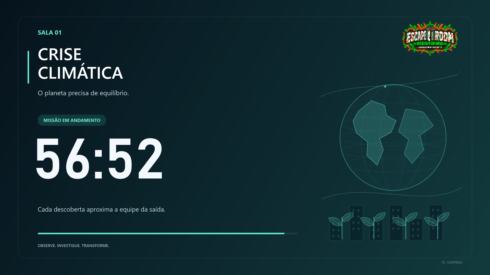

# Escape Room Científico - Materiais atualizados

Cards dos desafios, materiais do monitor e cronômetro para três salas. Revisão dos cards de 11/11/2026, versão 2.

## Downloads

**[Baixar todos os materiais](https://github.com/multiversodamente-ui/escape-room-materiais/releases/latest/download/Escape_Room_Materiais_Atualizados.zip)**

- [Cards atualizados para impressão - três por folha A4](cards/Jogadores/Cards_Atualizados_3_por_A4.pdf)
- [Texto editável dos cards](cards/Jogadores/Cards_Atualizados_Editavel.md)
- [Cartão de revelação de Energia Solar - uso do monitor](cards/Monitor/Energia_Solar_Cartao_Envelope.pdf)
- [Notas e preparação do monitor](cards/Monitor/Notas_do_Monitor.md)
- [Página da versão para download](https://github.com/multiversodamente-ui/escape-room-materiais/releases/latest)

## Cards da versão atual

- **Ilhas de Calor:** plantar três árvores conforme as anotações do cientista; a temperatura ideal revela o envelope da vitória.
- **Rede Climática Inteligente:** comparar os registros de Ar que Respiramos e Ilhas de Calor com o cenário ideal e calcular as diferenças.
- **Turbina Eólica:** variar a velocidade do vento e observar os LEDs acenderem.
- As demais alterações da revisão anterior foram preservadas. O conjunto contém 15 cards em cinco páginas, com logo, cores e bordas tracejadas arredondadas.

A pasta **Monitor** contém respostas e códigos; destine-a à organização. Os cards descrevem as regras revisadas: esta publicação não atualiza automaticamente os APKs ou as placas das estações.

---

## Cronômetro Escape Room — Três Salas

Aplicativo para Windows com **um único tempo sincronizado em três telas**, temas animados e efeitos sonoros automáticos.

## Baixar e usar

**[Baixar o pacote completo para Windows](https://github.com/multiversodamente-ui/escape-room-materiais/releases/latest/download/Cronometro_Tres_Salas_Windows.zip)**

[Baixar somente o aplicativo](https://github.com/multiversodamente-ui/escape-room-materiais/releases/latest/download/Cronometro_Tres_Salas.exe) · [Página de downloads](https://github.com/multiversodamente-ui/escape-room-materiais/releases/latest)

1. Extraia o ZIP e abra **Cronometro Tres Salas.exe**.
2. Conecte as telas ao mesmo computador e selecione **Estender** nas configurações de vídeo do Windows.
3. No aplicativo, escolha uma tela e uma saída de áudio para cada sala. Use **Testar som**.
4. Ajuste **Tempo e sons**, clique em **Projetar nas 3 telas** e inicie a contagem.

O programa funciona sem internet. Os sons e a logo já estão incorporados ao executável. Com menos de três telas, é possível usar **Prévia dos três temas**.

## Temas

| Sala | Tema |
|---|---|
| 01 | Crise Climática |
| 02 | Segurança Alimentar |
| 03 | Energia do Futuro |



## Sons e controle

Oito efeitos se alternam durante a contagem: alarme, sirene, estrondo, explosão, impacto grave, queda de frequência, descarga elétrica e faíscas. A sequência usa todos os efeitos selecionados antes de recomeçar e evita repetição imediata quando há mais de uma opção. O som final é configurado separadamente.

| Ritmo | Disparos em 60 minutos, incluindo o final |
|---|---:|
| Leve | 17 |
| Equilibrado — padrão | 25 |
| Intenso | 45 |

No último minuto os intervalos diminuem. A janela **Ver programação** mostra os horários e os efeitos da rodada atual. Uma saída de áudio selecionada mais de uma vez recebe apenas uma reprodução por evento.

**F2** na projeção abre o painel; **ESC** no painel retorna à projeção. **ESPAÇO** no painel inicia ou pausa. **F11** em uma projeção alterna tela cheia. **Missão concluída** interrompe a contagem e os sons futuros.

Consulte [as instruções completas](docs/LEIA_PRIMEIRO.txt) e [a programação de exemplo](docs/Programacao_60_minutos.csv).

## Verificação

A contagem, as pausas, o encerramento, a programação e a alternância dos sons foram verificadas automaticamente. As três projeções recebem a mesma leitura do relógio. Os temas foram renderizados e conferidos. O envio simultâneo de dados silenciosos foi verificado nas duas saídas de áudio disponíveis no computador de preparação.

A reprodução audível e a distribuição nas três salas devem ser conferidas com as telas e caixas conectadas, usando **Testar som**. O aplicativo não mede fisicamente se uma caixa produziu som.

## Compilar

Código em C# e WPF, usando o compilador do .NET Framework do Windows. Em PowerShell, na pasta deste repositório:

```powershell
.\build.ps1
```

O resultado é criado em `dist`. Para executar a verificação interna sem abrir janelas:

```powershell
$app = Join-Path $PWD 'dist\Cronometro Tres Salas.exe'
$report = Join-Path $PWD 'dist\verificacao.txt'
Start-Process -FilePath $app -ArgumentList ('--self-test "' + $report + '"') -WindowStyle Hidden -Wait
Get-Content -LiteralPath $report
```

## Créditos

Os efeitos de terceiros têm licenças próprias, identificadas em [CREDITOS.txt](CREDITOS.txt), também disponível no aplicativo. A logo do evento não está abrangida pelas licenças dos sons.
